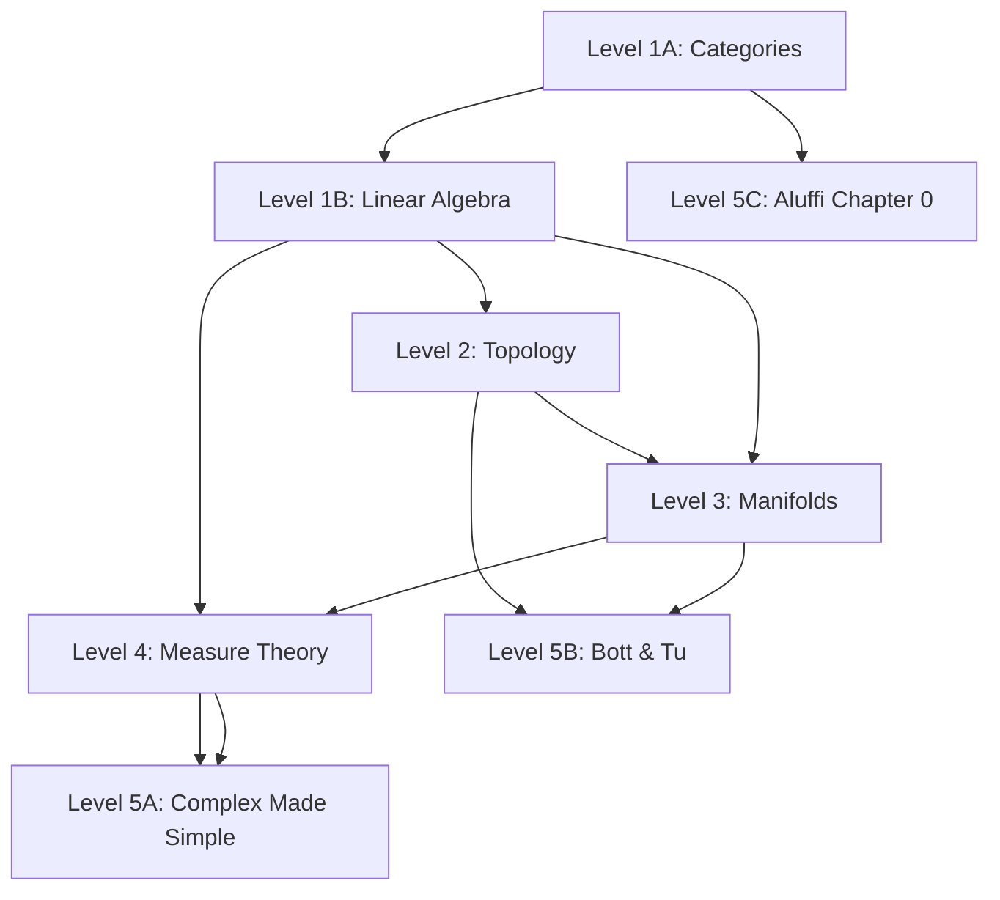

<!-- Breadcrumb Schema for SEO -->

This course is separate from the reference tracks on this site. The reference
tracks are an encyclopaedia: alphabetical, cross-linked, no required order.
This course is the opposite – a linear sequence where page N assumes page N−1,
designed so that no concept you meet depends on a concept you have not yet
learned.

## The Five Levels

| Level | Theme | Key texts | What you gain |
|---|---|---|---|
| **1** | Language & the Multilinear Engine | Lawvere & Schanuel (Categories); Treil (Linear Algebra Done Wrong) | Arrows, universal properties, coordinate-free linear algebra, exterior forms |
| **2** | The Canvas | Bradley, Bryson, Terilla (Topology); Jänich (companion) | Continuity, compactness, connectedness as pure qualitative geometry |
| **3** | Calculus as Linearization | Loring Tu (An Introduction to Manifolds) | Smooth manifolds, differential forms, the Generalised Stokes' Theorem |
| **4** | Global Analysis | Schilling (Measures, Integrals and Martingales); Körner (companion) | Measure spaces, the Lebesgue integral, $L^p$ spaces, functional duality |
| **5** | The Syntheses | Ullrich (Complex Made Simple); Bott & Tu (Differential Forms in Algebraic Topology); Aluffi (Algebra: Chapter 0) | Complex analysis re-seen through forms; de Rham cohomology; homological algebra |

## The Dependency Graph

<!-- COURSE-MAP:START -->
## The Course Map

The reader arrives knowing how to read. The course builds the rest in
dependency order: logic before counting, counting before the number line, the
number line before algebra, algebra before structure, structure before the
continuum, and the continuum before everything that measures it.
The full course is 56 chapters across 12 dependency stages, from
logic to Galois. The graph is machine-checked: `docs/course-graph.json` is
validated for acyclicity and order-consistency on every push, and the same
data generates a Lean 4 proof, checked in CI, that the dependency order is
well-founded.

| Chapter | Title | Status |
|---|---|---|
| **Stage A — Reasoning** | *Logic, sets, relations, functions. No numbers.* | |
| A1 | Propositions, quantifiers, and what a proof is | queued |
| A2 | Sets: membership, products, power sets | queued |
| A3 | Relations: order, equivalence | queued |
| A4 | Functions: injections, surjections, bijections, composition | queued |
| A5 | Proof strategies in action: the false proof, dissected | queued |
| **Stage B — Counting** | *Peano, induction, arithmetic as theorems.* | |
| B1 | The Peano axioms: what counting is | queued |
| B2 | Addition defined recursively; its laws proved | queued |
| B3 | Multiplication, order, exponentiation: all theorems | queued |
| B4 | Division with remainder; the Archimedean property | queued |
| **Stage C — Expanding the line** | *Z, Q, and the first crisis.* | |
| C1 | The failure of subtraction; Z as difference classes | queued |
| C2 | The failure of division; Q as fraction classes; density | queued |
| C3 | The first crisis: x^2 = 2 has no rational solution | queued |
| **Stage D — The continuum** | *R constructed; completeness proved; cardinality.* | |
| D1 | Dedekind cuts: R constructed from order alone | queued |
| D2 | Arithmetic and completeness of R, proved | queued |
| D3 | Decimals, roots, the place of Q inside R | queued |
| D4 | Cardinality: countable Q, uncountable R | queued |
| **Stage E — Completing algebra** | *Polynomials, C, and the FTA debt.* | |
| E1 | Polynomials as formal objects | queued |
| E2 | C built as pairs with a multiplication rule | queued |
| E3 | The fundamental theorem of algebra: statement, consequences, and the debt (debt: fundamental-theorem-of-algebra → K3) | queued |
| **Stage F — Structure and linear algebra** | *Categories and linear algebra over R and C.* | |
| F1 | Categories: objects, morphisms, universal properties, adjunctions | written |
| F2 | Vector spaces, linear maps, dimension | written |
| F3 | Duality and the double dual | written |
| F4 | Quotient spaces and their universal property | written |
| F5 | Determinants as alternating forms | written |
| F6 | Exterior algebra | written |
| F7 | Eigenstructure, triangularisation, Cayley-Hamilton (debt: fundamental-theorem-of-algebra → K3) | written |
| F8 | Inner products, orthogonality, the spectral theorem (debt: fundamental-theorem-of-algebra → K3) | written |
| F9 | Canonical forms: what remains when diagonalisation fails | queued |
| **Stage G — Euclidean analysis** | *Convergence, continuity, the derivative, the chain rule, the IFT, the elementary functions. Discharges the multivariable debts of the manifold chapters.* | |
| G1 | Convergence of sequences in R and R^n | queued |
| G2 | Continuity in several variables | queued |
| G3 | The derivative in several variables | queued |
| G4 | The chain rule, partials, and Clairaut | queued |
| G5 | The inverse function theorem | queued |
| G6 | The exponential and trigonometric functions via power series | queued |
| **Stage H — The canvas** | *Metric and topological spaces, connectedness, compactness.* | |
| H1 | Metric and topological spaces, continuity, homeomorphism (debt: completeness-axiom → D2, elementary-functions-continuity → G6) | written |
| H2 | Connectedness and compactness; the IVT and EVT | written |
| **Stage I — Measure** | *Sigma-algebras to Fourier. Discharges the Fubini and change-of-variables debts.* | |
| I1 | Sigma-algebras and measures | queued |
| I2 | The Lebesgue integral: Caratheodory | queued |
| I3 | Modes of convergence | queued |
| I4 | L^p spaces and duality | queued |
| I5 | Product measures and Fubini-Tonelli; the change-of-variables formula | queued |
| I6 | Radon-Nikodym and conditional expectation | queued |
| I7 | Fourier series and the Fourier transform | queued |
| **Stage J — Calculus as linearisation** | *Manifolds, tangent spaces, forms, partitions of unity, integration and Stokes.* | |
| J1 | Smooth manifolds: charts, atlases, smooth maps (debt: multivariable-chain-rule → G4, multivariable-inverse-function-theorem → G5, trigonometry-facts → G6) | written |
| J2 | Tangent spaces, the differential, the IFT on manifolds (debt: fundamental-theorem-of-calculus → G4, differentiation-under-the-integral → I5) | written |
| J3 | Differential forms and the exterior derivative (debt: clairaut-mixed-partials → G4) | written |
| J4 | Partitions of unity | queued |
| J5 | Integration, orientation, and Stokes (debt: fubini-theorem → I5, change-of-variables-formula → I5, partitions-of-unity-existence → J4) | written |
| J6 | Submanifolds, immersions, regular level sets | queued |
| J7 | Lie groups and group actions | queued |
| **Stage K — Complex analysis** | *Holomorphy, Cauchy, residues, and the FTA proved — the ledger closes.* | |
| K1 | Holomorphy: complex differentiability and its rigidity | queued |
| K2 | Complex integration, Cauchy's theorem, residues | queued |
| K3 | The fundamental theorem of algebra, proved - the ledger closes | queued |
| **Stage L — Algebra and symmetry** | *Groups, rings and modules, Galois.* | |
| L1 | Groups through the categorical lens | queued |
| L2 | Rings and modules | queued |
| L3 | Galois theory: symmetry of equations | queued |

The declared-input ledger is visible in the map: a chapter carrying a debt
shows the input and the chapter that discharges it. The ledger's first debt
(the fundamental theorem of algebra, declared at E3 and used at F7 and F8)
is paid at K3, where the theorem is finally proved. Every debt in the
ledger has a payee, and the machine check enforces it.

The reference tracks in the sidebar remain the encyclopaedia; this course is
the path through it.
<!-- COURSE-MAP:END -->

## The Mastery Methodology

This course integrates five learning protocols designed for self-directed study
without the artificial forcing function of exams.

### The One-Line Reveal

Never read a proof straight through. Read the theorem statement. Close the
book. Spend fifteen minutes attempting the proof or identifying the exact
technical roadblock. If stuck, open the book and read *only the first sentence*
of the author's proof – that sentence almost always introduces the trick or
auxiliary object. Close the book again and finish the proof yourself. This turns
passive consumption into active discovery.

### The Living Monograph

Write your own unified exposition targeting an intelligent version of yourself
from six months ago. For every core concept, include:

1. **The Defect**: what broke that made this definition necessary?
2. **The Universal Property or Diagram**: the commutative diagram or the precise
   statement.
3. **The Extremes**: the trivial example, the canonical workhorse, and the
   counterexample that breaks when you drop one axiom.
4. **The Pivot**: the single line in any long proof where the crucial conceptual
   shift happens.

### The 80/20 Problem Filter

Skip computational drills. Do classification problems ("classify all groups of
order 8"), counterexample challenges ("show the theorem fails if axiom X is
omitted"), and omitted lemmas (when an author defers a verification to the
reader, treat that as mandatory).

### Section Checkpoints and Problems

Mathematics is learned by doing, not by reading. Every numbered section of
every page ends with a **Quick check**: five short questions with terse
answers, testing exactly what the section proved. Do them before moving on;
if one fails, reread only that section. Every page then ends with
**Problems**: multi-step chains that require written arguments, with hints
where the jump is large. The One-Line Reveal tells you what to attempt
before reading; the quick checks keep you honest while reading; the problems
are where you find out whether you can do it.

### The 3-Month Retrospective

Every week, spend forty-five minutes on a blank-page retrieval drill from two
levels back. Write the definition, the theorem hypotheses, the mental picture,
and the proof architecture from memory. If you cannot, you have found a crack
before it causes structural collapse.

### Managing Cognitive Stalling

When stuck: drop one dimension (solve on a 2-sphere or in **Set** instead), or
apply the 48-hour incubation rule – write the obstacle in one plain English
question, close the book, and walk away. Subconscious processing in mathematics
is a documented reality.

## The Pages

| Page | Level | Content |
|---|---|---|
| [Categories: The Language of Mathematics](/17-core-course/1a-categories/) | 1A | Objects, morphisms, universal properties, functors, natural transformations |
| [Linear Algebra Done Wrong](/17-core-course/1b-linear-algebra/) | 1B | Coordinate-free vector spaces, dual spaces, quotient spaces, exterior algebra, determinants as alternating forms |
| [Level 2: Topology](/17-core-course/2a-topology/) | 2 | Metric and abstract topologies, continuity, subspaces and products, Hausdorff, connectedness (intermediate value theorem), compactness (extreme value theorem) |
| [Level 3A: Smooth Manifolds](/17-core-course/3a-manifolds/) | 3A | Differentiability in Euclidean space, charts and atlases, locality and the maximal-atlas theorem with uniqueness, the stereographic sphere, smooth maps and diffeomorphisms, dimension as an invariant |
| [Level 3B: Tangent Spaces](/17-core-course/3b-tangent-space/) | 3B | Derivations on germs, Hadamard's lemma, the chart transport and change-of-basis law, the differential as the Jacobian, the manifold chain rule, the inverse function theorem on manifolds |
| [Level 3C: Differential Forms](/17-core-course/3c-forms/) | 3C | Forms as determinant evaluators, the wedge with definitional associativity, the exterior derivative with d² = 0, the graded Leibniz rule, pullback commutation, coordinate independence of d |
| [Level 3D: Integration and Stokes](/17-core-course/3d-stokes/) | 3D | Manifolds with boundary, orientation and the outward-first boundary convention proved well defined, chart and partition-of-unity integration, the local Stokes theorem by Fubini and FTC, the generalised Stokes theorem, and the classical Green, divergence, and Stokes theorems as coordinate expansions |

Levels 4–5 are under construction. The dependency graph above shows the
planned structure.
