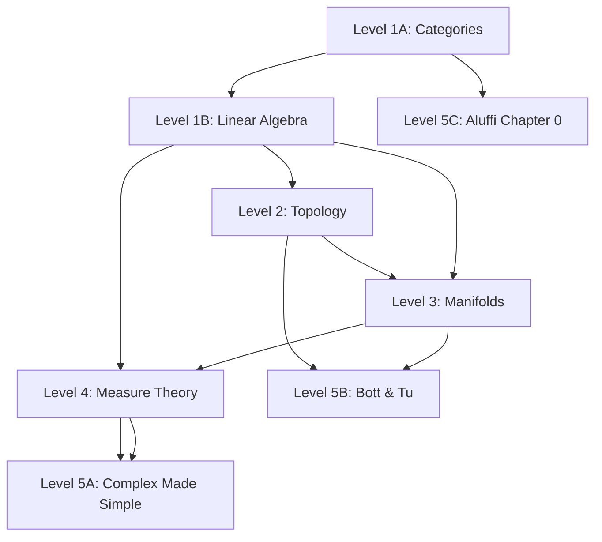

<!-- Breadcrumb Schema for SEO -->

This course is separate from the reference tracks on this site. The reference
tracks are an encyclopaedia: alphabetical, cross-linked, no required order.
This course is the opposite – a linear sequence where page N assumes page N−1,
designed so that no concept you meet depends on a concept you have not yet
learned.

## The Five Levels

| Level | Theme | Key texts | What you gain |
|---|---|---|---|
| **1** | Language & the Multilinear Engine | Lawvere & Schanuel (Categories); Treil (Linear Algebra Done Wrong) | Arrows, universal properties, coordinate-free linear algebra, exterior forms |
| **2** | The Canvas | Bradley, Bryson, Terilla (Topology); Jänich (companion) | Continuity, compactness, connectedness as pure qualitative geometry |
| **3** | Calculus as Linearization | Loring Tu (An Introduction to Manifolds) | Smooth manifolds, differential forms, the Generalised Stokes' Theorem |
| **4** | Global Analysis | Schilling (Measures, Integrals and Martingales); Körner (companion) | Measure spaces, the Lebesgue integral, $L^p$ spaces, functional duality |
| **5** | The Syntheses | Ullrich (Complex Made Simple); Bott & Tu (Differential Forms in Algebraic Topology); Aluffi (Algebra: Chapter 0) | Complex analysis re-seen through forms; de Rham cohomology; homological algebra |

## The Dependency Graph

## The Course Map

Eight chapters are written. The full course is forty-two. Each chapter is a
book-scale unit with section quick checks and end-of-page problems; the table
below is the complete dependency-ordered syllabus, and it is the build order.

| Chapter | Title | Status |
|---|---|---|
| **Level 1 — Language and the Multilinear Engine** | | |
| 1A | Categories: objects, morphisms, universal properties, functors, adjunctions | written |
| 1B | Linear algebra: spaces, duality, quotients, determinants, exterior algebra | written |
| 1C | Eigenvectors, diagonalisation, and the spectral theorem | queued |
| 1D | Inner products, orthogonality, adjoints, the Gram–Schmidt process | queued |
| 1E | Canonical forms and the fundamental theorem of linear algebra | queued |
| **Level 2 — Topology: The Canvas** | | |
| 2A | Metric spaces, topological spaces, continuity, homeomorphism | written |
| 2B | Connectedness and compactness, with the IVT and EVT as theorems of space | written |
| 2C | The quotient topology, gluing, and topological constructions | queued |
| 2D | Sequences, convergence, completeness, and the $p$-adic warning | queued |
| 2E | Separation axioms, countability, and metrisation | queued |
| **Level 3 — Calculus as Linearization** | | |
| 3A | Smooth manifolds: charts, atlases, smooth maps | written |
| 3B | Tangent spaces, the differential, the inverse function theorem | written |
| 3C | Differential forms and the exterior derivative | written |
| 3D | Integration, orientation, and Stokes | written |
| 3E | Submanifolds, immersions, submersions, and regular level sets | queued |
| 3F | Lie groups and group actions | queued |
| **Level 4 — Global Analysis** | | |
| 4A | $\\sigma$-algebras and measures | queued |
| 4B | Construction of the Lebesgue integral: Carathéodory | queued |
| 4C | Modes of convergence: pointwise, uniform, almost everywhere, in measure | queued |
| 4D | $L^p$ spaces, Hölder and Minkowski, duality | queued |
| 4E | Product measures and Fubini–Tonelli | queued |
| 4F | Radon–Nikodym, conditional expectation, martingales | queued |
| 4G | Fourier series and the Fourier transform | queued |
| **Level 5 — The Syntheses** | | |
| 5A | Holomorphic functions: complex differentiability and its rigidity | queued |
| 5B | Complex integration, Cauchy's theorem, residues | queued |
| 5C | De Rham cohomology: the degree of a map, the Poincaré lemma | queued |
| 5D | The Mayer–Vietoris sequence and homotopy invariance | queued |
| 5E | Groups, rings, and modules through the categorical lens | queued |
| 5F | Galois theory: symmetry of equations | queued |

The reference tracks in the sidebar remain the encyclopaedia; this course is
the path through it.

## The Mastery Methodology

This course integrates five learning protocols designed for self-directed study
without the artificial forcing function of exams.

### The One-Line Reveal

Never read a proof straight through. Read the theorem statement. Close the
book. Spend fifteen minutes attempting the proof or identifying the exact
technical roadblock. If stuck, open the book and read *only the first sentence*
of the author's proof – that sentence almost always introduces the trick or
auxiliary object. Close the book again and finish the proof yourself. This turns
passive consumption into active discovery.

### The Living Monograph

Write your own unified exposition targeting an intelligent version of yourself
from six months ago. For every core concept, include:

1. **The Defect**: what broke that made this definition necessary?
2. **The Universal Property or Diagram**: the commutative diagram or the precise
   statement.
3. **The Extremes**: the trivial example, the canonical workhorse, and the
   counterexample that breaks when you drop one axiom.
4. **The Pivot**: the single line in any long proof where the crucial conceptual
   shift happens.

### The 80/20 Problem Filter

Skip computational drills. Do classification problems ("classify all groups of
order 8"), counterexample challenges ("show the theorem fails if axiom X is
omitted"), and omitted lemmas (when an author writes "the reader can easily
verify," treat that as mandatory).

### Section Checkpoints and Problems

Mathematics is learned by doing, not by reading. Every numbered section of
every page ends with a **Quick check**: five short questions with terse
answers, testing exactly what the section proved. Do them before moving on;
if one fails, reread only that section. Every page then ends with
**Problems**: multi-step chains that require written arguments, with hints
where the jump is large. The One-Line Reveal tells you what to attempt
before reading; the quick checks keep you honest while reading; the problems
are where you find out whether you can do it.

### The 3-Month Retrospective

Every week, spend forty-five minutes on a blank-page retrieval drill from two
levels back. Write the definition, the theorem hypotheses, the mental picture,
and the proof architecture from memory. If you cannot, you have found a crack
before it causes structural collapse.

### Managing Cognitive Stalling

When stuck: drop one dimension (solve on a 2-sphere or in **Set** instead), or
apply the 48-hour incubation rule – write the obstacle in one plain English
question, close the book, and walk away. Subconscious processing in mathematics
is a documented reality.

## The Pages

| Page | Level | Content |
|---|---|---|
| [Categories: The Language of Mathematics](/17-core-course/1a-categories/) | 1A | Objects, morphisms, universal properties, functors, natural transformations |
| [Linear Algebra Done Wrong](/17-core-course/1b-linear-algebra/) | 1B | Coordinate-free vector spaces, dual spaces, quotient spaces, exterior algebra, determinants as alternating forms |
| [Level 2: Topology](/17-core-course/2a-topology/) | 2 | Metric and abstract topologies, continuity, subspaces and products, Hausdorff, connectedness (intermediate value theorem), compactness (extreme value theorem) |
| [Level 3A: Smooth Manifolds](/17-core-course/3a-manifolds/) | 3A | Differentiability in Euclidean space, charts and atlases, locality and the maximal-atlas theorem with uniqueness, the stereographic sphere, smooth maps and diffeomorphisms, dimension as an invariant |
| [Level 3B: Tangent Spaces](/17-core-course/3b-tangent-space/) | 3B | Derivations on germs, Hadamard's lemma, the chart transport and change-of-basis law, the differential as the Jacobian, the manifold chain rule, the inverse function theorem on manifolds |
| [Level 3C: Differential Forms](/17-core-course/3c-forms/) | 3C | Forms as determinant evaluators, the wedge with definitional associativity, the exterior derivative with d² = 0, the graded Leibniz rule, pullback commutation, coordinate independence of d |
| [Level 3D: Integration and Stokes](/17-core-course/3d-stokes/) | 3D | Manifolds with boundary, orientation and the outward-first boundary convention proved well defined, chart and partition-of-unity integration, the local Stokes theorem by Fubini and FTC, the generalised Stokes theorem, and the classical Green, divergence, and Stokes theorems as coordinate expansions |

Levels 4–5 are under construction. The dependency graph above shows the
planned structure.
